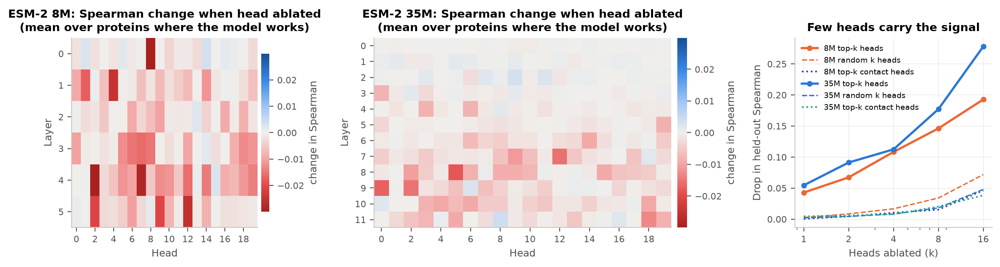

# PLM Interpreter

Mechanistic interpretability of ESM-2 protein language models: **why** does the model think a
mutation is harmful, and can we trust that explanation?

ESM-2 scores a missense variant zero-shot by masking the site and comparing the model's
probability of the mutant and wild-type amino acids (the masked-marginal log-likelihood ratio,
LLR). This project explains that score at three levels and checks every explanation against
experimental data and protein structure:

| Level | Question | Method | Checked against |
|---|---|---|---|
| Residues | Which other residues drove this variant's score? | Integrated gradients, occlusion | AlphaFold2 3D contacts; deletion test |
| Components | Which attention heads / MLPs does variant prediction depend on? | Mean-ablation of every head, layer and MLP | Held-out positions; random-head controls; contact heads |
| Layers | What does each layer know, and when does the variant signal appear? | Linear probes; logit lens | DSSP, solvent accessibility, MSA conservation; DMS data |

Models: ESM-2 8M (6 layers × 20 heads) and 35M (12 × 20), CPU only.
Data: ProteinGym v1.2 (217 deep mutational scanning assays, 2,525 clinical variant sets,
AlphaFold2 structures, MSAs).

## Quick start

```bash
conda env create -f environment.yml
conda activate plm-interp
pip install -r requirements.lock.txt --extra-index-url https://download.pytorch.org/whl/cpu
pip install -e .

python scripts/01_download_models.py   # ESM-2 8M and 35M -> models/
python scripts/02_download_data.py     # ProteinGym v1.2 -> data/raw/ (md5-verified)
```

## Key findings

1. **The scores are reproduced exactly.** Our masked-marginal scores match ProteinGym's published
   Spearman within 0.01 for all 217 assays and both models (mean 0.319 for 35M, 0.206 for 8M). On 62,727
   curated clinical variants across 2,525 human genes, the 35M score separates pathogenic from benign with
   AUROC 0.744 (8M: 0.649).
2. **Structure is learned, not built in.** Linear probes recover secondary structure (balanced accuracy
   0.80 vs 0.45 from residue identity alone), burial, solvent accessibility, contact number and
   conservation from held-out proteins. The signal grows with depth and is absent in a randomly initialised model.
3. **A handful of late heads are contact detectors.** In ESM-2 35M, head L11H13 ranks true 3D contacts with
   precision@L 0.39, 11x the 3.5% base rate; no random-init head exceeds 0.06.
4. **Single-variant explanations point at 3D neighbours.** Integrated-gradients importance identifies
   residues in 3D contact with the mutated site (AUROC 0.74-0.75; 0.60 for long-range contacts only; 0.46-0.52
   for a random-init model), and masking the top-attributed residue moves the score about 10x more than
   masking a random one. Simple sequence proximity is a strong baseline (AUROC 0.86): much of what the
   model uses is local sequence context.
5. **Variant prediction depends on a few heads, and they are not the contact heads.** Across 24 proteins,
   ablating the 16 heads that matter most on one half of the positions lowers Spearman on the other half by
   0.28 (ESM-2 35M), against 0.05 for 16 random heads; the top heads beat random heads in 23 of 24 proteins
   (sign test p = 1.5e-6). Ablating the 16 best contact-detector heads costs only 0.04, about the same as
   random heads.
6. **The heads that matter look locally.** From the masked site, the 10 most important heads of ESM-2 35M put
   60% of their attention on residues 1-4 positions away (other heads: 23%), look about 5 residues away on
   average (others: 25) and attend to 3D contacts less than other heads. None of them is among the top 10
   contact heads, in either model. This explains finding 4: the variant verdict is built mainly from local
   sequence context, while the fold-sensing machinery sits elsewhere.
7. **The variant signal forms late.** Decoded with the logit lens, the variant score only correlates with
   experiments in the last third of the network (35M: Spearman about 0 at layers 4-8, 0.34 at layer 12).
8. **The model detects damage, not improvement.** Across 209 assays, the 35M score ranks variants well within
   the most damaging quarter (Spearman 0.18) but barely within the best quarter (0.04); this holds in 74% of
   assays and 88% of stability assays (p < 0.001). The score reflects evolutionary plausibility rather than
   function: in HRas, the oncogenic hotspots G12V, G13D and Q61L work normally or better in the lab, yet the
   model rates them unusual. (Measurement noise among near-neutral variants may account for part of the
   asymmetry.)

## Results

All results are in [`results/`](results/):

- [`results/report.md`](results/report.md): every headline table (baseline, probing, attention, attribution,
  ablation, logit lens, damage vs improvement, head roles, case studies).
- [`results/claims.md`](results/claims.md): every claim with its effect size, 95% bootstrap CI, control and
  FDR-corrected permutation test.
- [`results/figures/`](results/figures/): paper figures (PNG and PDF).
- [`results/tables/`](results/tables/): the per-stage CSV tables the report is built from.
- [`results/case_studies/35M/index.html`](results/case_studies/35M/index.html): interactive explanation cards for
  21 variants in five disease proteins (HRas, TPK1, OTC, HMBS, p53).



## Live demo

A local web app walks through the whole idea on real proteins: pick a protein, hide one residue,
see ESM-2's guess for all 20 amino acids, score a mutation against the lab measurement, then ask
why (residue importance painted on the AlphaFold2 structure) and look inside the model (score after
every layer, effect of switching off each attention head). It also includes the findings and figures.

```bash
python -m plm_interp.app --warm   # first time: precomputes the showcase examples (cached on disk)
python -m plm_interp.app          # afterwards: starts instantly and opens http://127.0.0.1:8000
```

Everything runs offline on the CPU (the 3D viewer and fonts are bundled).

## Reproducing the pipeline

Scripts are numbered in run order. Each reads the previous stages' outputs, can be re-run safely
(finished work is skipped), and writes tables to `results/tables/<stage>/`. Settings live in
[`configs/default.yaml`](configs/default.yaml).

| Script | What it does | Output |
|---|---|---|
| `01_download_models.py` | Download ESM-2 8M and 35M | `models/` |
| `02_download_data.py` | Download ProteinGym v1.2 (DMS, clinical, AF2 structures, MSAs) | `data/raw/` |
| `03_baseline.py` | Zero-shot scores for every assay and clinical set; compare with ProteinGym's published numbers | `tables/baseline/` |
| `04_annotate.py` | Per-residue labels from AF2 structures and MSAs for 60 proteins | `data/processed/annotations/` |
| `05_probing.py` | Linear probes per layer (held-out proteins) | `tables/probing/` |
| `06_attention_contacts.py` | Attention heads vs 3D contact maps | `tables/attention/` |
| `07_attribution.py` | Integrated gradients and occlusion for sampled variants; contact AUROC; deletion test | `tables/attribution/` |
| `08_head_ablation.py` | Ablate every head, layer and MLP; top-k vs random-k heads on held-out positions | `tables/ablation/` |
| `09_logit_lens.py` | Variant signal decoded from every layer | `tables/logit_lens/` |
| `10_evolution_vs_function.py` | Does the score rank damage and improvement equally well? (all assays) | `tables/evolution_vs_function/` |
| `11_head_roles.py` | What the heads that matter for variant scores attend to | `tables/head_roles/` |
| `12_verification.py` | Effect sizes, bootstrap CIs, permutation tests and FDR for every claim | `claims.md` |
| `13_figures.py` | Paper figures | `figures/` |
| `14_case_studies.py` | Per-variant explanation cards with 3D views | `case_studies/` |
| `15_report.py` | Collect the headline numbers into one report | `report.md` |

```bash
for s in scripts/[0-9][0-9]_*.py; do python "$s"; done
pytest
```

The full baseline (both models, all assays and clinical sets) takes several hours on an 8-core CPU;
every other stage takes minutes to about an hour.

## Design decisions

- **What is explained.** Always the masked-marginal LLR at the mutated site, the same quantity
  ProteinGym benchmarks. Because the site is masked, wild-type and mutant inputs are identical,
  so explanations perturb the *context* (other residues, heads, layers), never the site itself.
- **Correctness gate.** Our scores reproduce ProteinGym's published per-assay Spearman for both
  models before any interpretation is run (see `tests/test_scoring.py`).
- **Integrated gradients baseline.** ESM-2 embeds `<mask>` as a zero vector, but its pre-LayerNorm
  blocks are scale invariant, so a zero baseline makes the path integral degenerate. We use the
  mean amino-acid embedding as the baseline, adapt the number of steps until the completeness
  axiom holds within 10%, and report the remaining gap for every variant. The model output can
  jump abruptly along the path, which is why a fixed small step count is not enough.
- **Controls everywhere.** Every analysis is repeated on a randomly initialised model with the
  same architecture; probes are compared with residue identity alone; heads are ranked on one half
  of the positions and evaluated on the other; attributions are compared with random and
  sequence-nearest residues.
- **Structural labels only where the structure is trustworthy.** Residues with AF2 pLDDT < 70
  are excluded from structure-based labels.
- **Plain PyTorch hooks** on HuggingFace `EsmForMaskedLM` (`src/plm_interp/models/hooks.py`);
  TransformerLens does not support the ESM architecture.

## Repository layout

```
configs/default.yaml        shared settings (models, showcase proteins, thresholds, seeds)
src/plm_interp/
  models/                   ESM-2 loading; hooks for residual/head capture and head ablation
  baseline/                 masked-marginal scoring, long-sequence windows
  data/                     ProteinGym loaders, structure labels (DSSP, RSA, contacts), MSA conservation
  attribution/              integrated gradients, occlusion, deletion test; attention vs contacts
  explain/                  probing, ablation, logit lens
  verification/             bootstrap CIs, permutation tests, BH-FDR
  viz/                      figure style
  app/                      local web demo (FastAPI server + static front end)
scripts/                    pipeline stages 01-15, in run order
tests/                      pytest suite (uses the 8M model)
results/                    report, verified claims, figures, tables, case-study cards
data/, models/              downloaded inputs and weights (not tracked; created by scripts 01-02)
```

## References

- Lin et al. 2023, *Evolutionary-scale prediction of atomic-level protein structure with a language model*, Science.
- Meier et al. 2021, *Language models enable zero-shot prediction of the effects of mutations on protein function*, NeurIPS.
- Notin et al. 2023, *ProteinGym: large-scale benchmarks for protein fitness prediction and design*, NeurIPS.
- Vig et al. 2021, *BERTology meets biology: interpreting attention in protein language models*, ICLR.
- Rao et al. 2021, *Transformer protein language models are unsupervised structure learners*, ICLR.
- Zhang et al. 2024, *Protein language models learn evolutionary statistics of interacting sequence motifs*, PNAS.
- Simon & Zou 2025, *InterPLM: discovering interpretable features in protein language models via sparse autoencoders*, Nature Methods.
- Sundararajan et al. 2017, *Axiomatic attribution for deep networks*, ICML.
- Adebayo et al. 2018, *Sanity checks for saliency maps*, NeurIPS.
- nostalgebraist 2020, *interpreting GPT: the logit lens*; Belrose et al. 2023, *Eliciting latent predictions from transformers with the tuned lens*.
